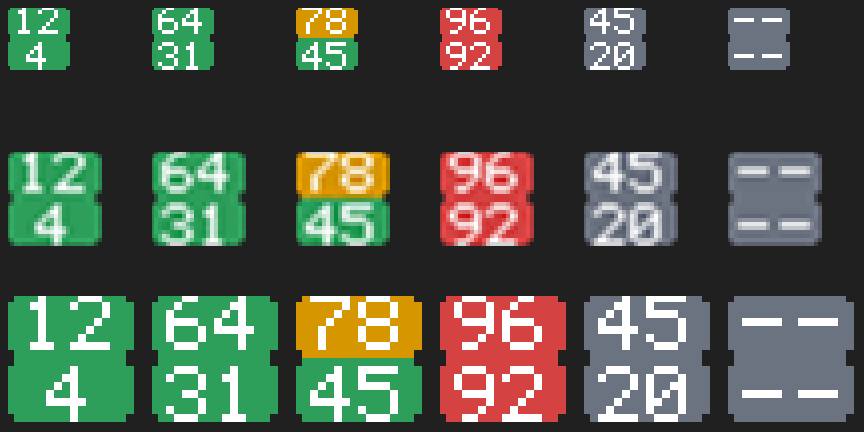

# Claude Meter Tray Icon

A small Windows tray app that shows your **Claude Code usage limits** live on the taskbar: the 5-hour and the 7-day window, with the percentage used and the time left until each one resets.



*Tray icon at 16, 24 and 32 px (columns: low, medium, amber, red, outdated, no data). Top half is the 5-hour window, bottom half is the 7-day window.*

> **Unofficial.** This is a community project. It is not made, endorsed or supported by Anthropic. "Claude" is a trademark of Anthropic. It uses an undocumented API that may change or stop working at any time (see [Caveats](#caveats)).

## What you get

- **Readout next to the tray**, like the `ENG IN` and battery indicators:

  ```
  7%  · 4:24        5-hour window: percent used · hours:minutes until reset
  11% · 2:17:24     7-day window:  percent used · days:hours:minutes until reset
  ```

  The percentage is green below 70%, amber at 70–89% and red from 90%. The countdown ticks live without calling the API.
- **Tray icon** with the same two numbers on a 16×16 pixel grid, for when the readout is hidden.
- **Honest numbers.** If a reading may be out of date it is greyed out and marked with `?`, and shown as `--` once it is too old to trust (see [below](#stale-numbers-are-never-shown-as-live)).
- Right-click menu with details, **Refresh now**, **Show text on taskbar** and **Start with Windows**.
- Quiet by design: gentle polling, rate-limit back-off, no window, no focus stealing, hides during full-screen apps.

## Requirements

- Windows 10 or 11 (horizontal taskbar, top or bottom)
- [.NET 10 SDK](https://dotnet.microsoft.com/download) to build it
- [Claude Code](https://claude.com/claude-code) installed and signed in with a Claude subscription. The app reuses its login.

## Run it

```powershell
git clone https://github.com/pramodkumar3901/Claude_Meter_Tray_Icon.git
cd Claude_Meter_Tray_Icon
```

Then double-click **`Launch-ClaudeMeter.cmd`**. It closes any running copy, builds, and starts the app again, so you can run it any time to restart.

Without the launcher:

```powershell
dotnet run -c Release
```

To build a folder you can keep anywhere:

```powershell
dotnet publish -c Release -r win-x64 --self-contained true -o publish
.\publish\ClaudeMeterTrayIcon.exe
```

**Start with Windows** is switched on the first time the built exe runs. It adds a per-user entry under `HKCU\Software\Microsoft\Windows\CurrentVersion\Run` (no admin rights). Untick it in the tray menu to turn it off; it then stays off. It is not registered under `dotnet run`, only for the built exe.

## How it works

1. Reads the Claude Code OAuth access token from `~/.claude/.credentials.json` (or `%CLAUDE_CONFIG_DIR%\.credentials.json`).
2. Calls `GET https://api.anthropic.com/api/oauth/usage` with that token and the `anthropic-beta: oauth-2025-04-20` header. This is the endpoint behind Claude Code's `/usage` view.
3. Reads `five_hour` and `seven_day` (`utilization` and `resets_at`) and redraws the icon and the readout.

### Privacy and security

- The token is sent **only** to `api.anthropic.com`. It is never logged, saved, or shown.
- The app **never refreshes the token and never writes** the credentials file. Refresh tokens rotate, so writing could log Claude Code out. Claude Code renews the access token when you use it; if the app says the login expired, use Claude Code once and it recovers on its own.
- The only thing the app writes is `%LOCALAPPDATA%\ClaudeMeterTrayIcon\state.json` (last reading and any rate-limit wait) and, for Start with Windows, the registry entries above. No usage data leaves your machine except the request to Anthropic.
- Claude Code does **not** need to be open while the app runs.

## Stale numbers are never shown as live

| Situation | Taskbar text | Tray icon |
|---|---|---|
| Fresh: under 5 min old and the last refresh worked | `9% · 4:17` in green / amber / red | coloured block |
| Last refresh failed, or reading over 5 min old | `9%? · 4:17` in grey | grey block with digits |
| Reading over 30 min old, or its window already reset | `-- · --` | grey block with `--` |

The menu says "may be outdated" or "no current data", and the status line shows when the last good reading was taken.

## Rate limits

The usage API rate-limits (HTTP 429) if called too often. The app asks every 3 minutes, honours `Retry-After`, and otherwise backs off 5 → 10 → 20 minutes. The last reading and any wait are saved to disk, so restarting the app does not trigger an immediate call. Manual refresh is limited to once per 30 seconds.

## Caveats

- The usage endpoint is **undocumented** and may change without notice. If it does, the app shows an error and the parser in [`src/UsageService.cs`](src/UsageService.cs) needs updating.
- The app assumes `utilization` is a percentage from 0 to 100.
- Only accounts that sign in to Claude Code with a Claude subscription (OAuth) are supported, not API keys.
- At 100% display scaling the tray icon is only 16 px, so its digits are small. Higher scaling gives a bigger icon, and the readout next to the tray is easier to read.
- Vertical taskbars are not supported for the readout (the tray icon still works).

## Project layout

```
ClaudeMeterTrayIcon.csproj   WinForms, .NET 10
Launch-ClaudeMeter.cmd/.ps1  one-click stop, build and start
src/Program.cs               entry point, tray icon, menu, polling and back-off
src/UsageService.cs          reads the token, calls the usage API, parses the reply
src/StateCache.cs            saves the last reading between runs
src/Freshness.cs             decides when a reading is fresh, outdated or unusable
src/IconRenderer.cs          draws the 16x16 pixel-font tray icon
src/TaskbarOverlay.cs        the text readout next to the tray
src/Startup.cs               "Start with Windows"
```

Render the icon states to a PNG without starting the tray:

```powershell
dotnet run -c Release -- --preview preview.png
```

## License

[MIT](LICENSE)
